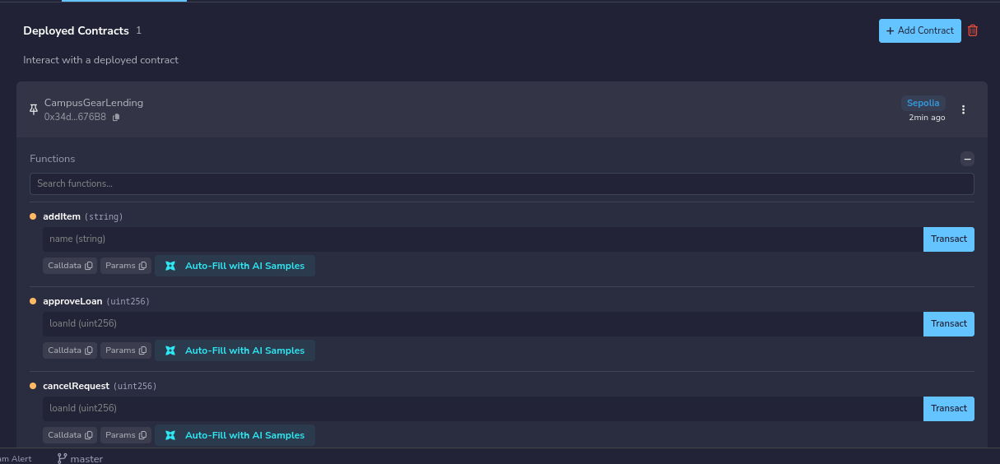
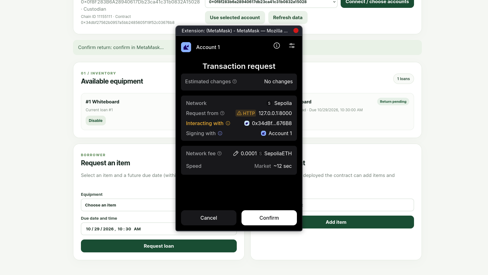
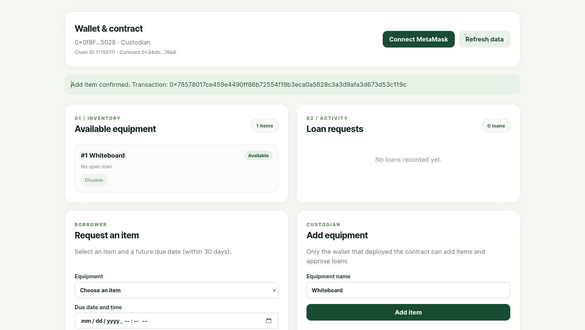
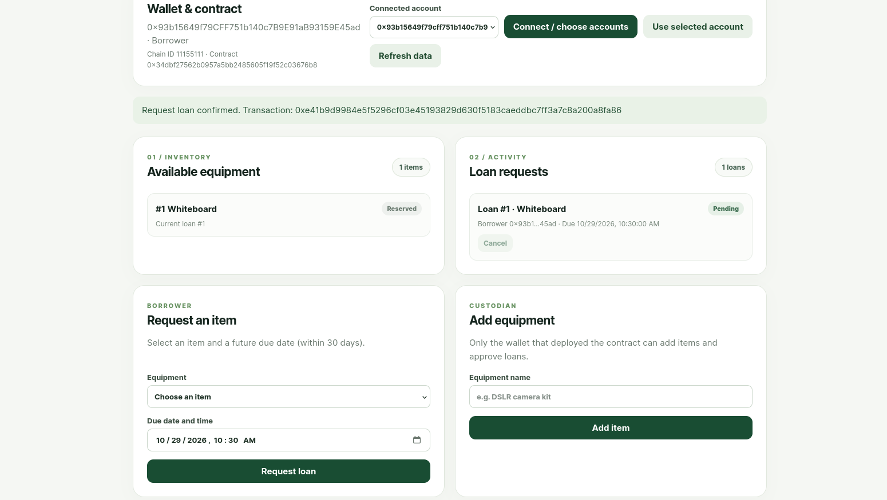
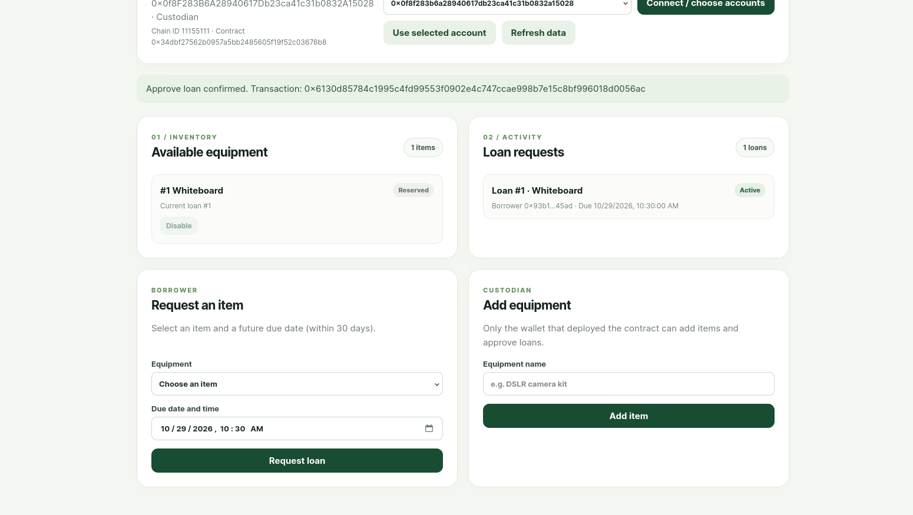
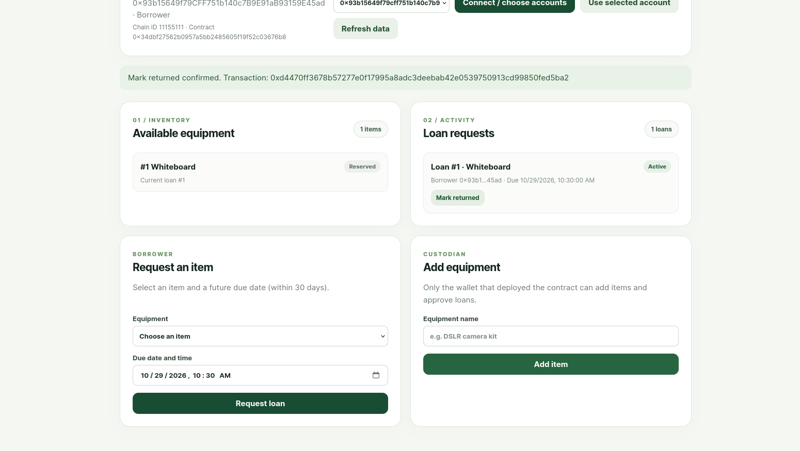
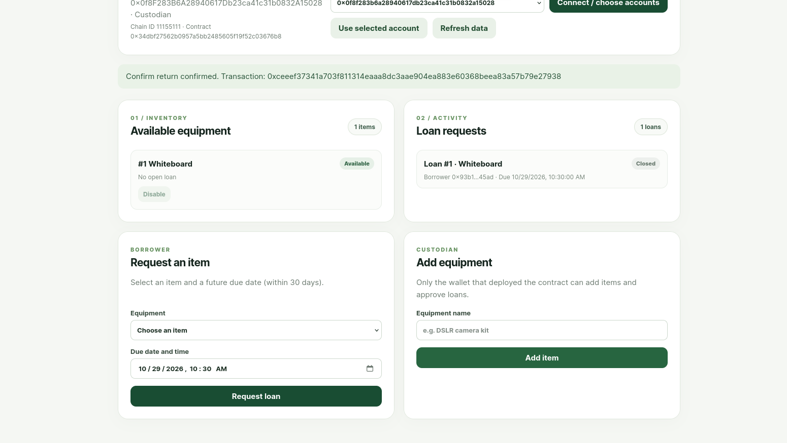
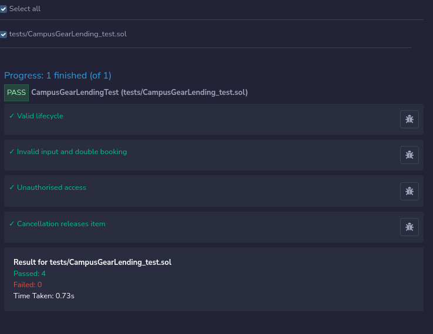
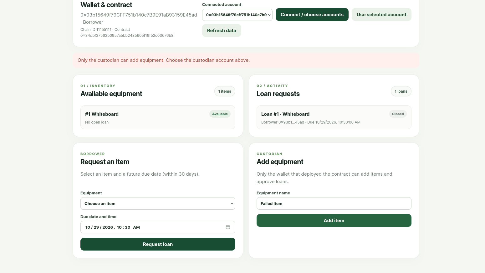
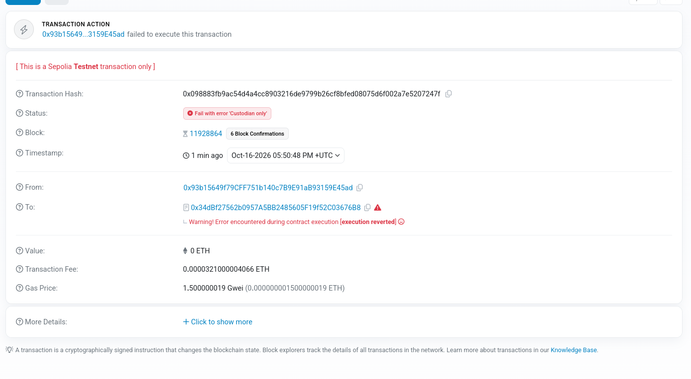

# Campus Gear Lending

**Blockchain Technology (CSE4444) — Assignment 2**

Application: Ethereum DApp for campus equipment lending. Deployment network: Sepolia testnet.

## Abstract

Campus departments often lend shared equipment through paper registers or messages. This makes item availability, borrower responsibility, and return status difficult to track. Campus Gear Lending records equipment and loan state in a Solidity smart contract. A browser interface connects to MetaMask through Ethers.js so borrowers can request items and a custodian can approve loans and confirm returns. The contract rejects invalid requests and actions by unauthorised wallets. The deployed Sepolia instance, a completed loan sequence, a failed authorisation transaction, and Remix test results are documented below.

## 1. Problem and objectives

The DApp addresses overlapping equipment reservations and unclear loan histories. Its objectives are to:

1. Record each item, loan, borrower address, due date, and status on the blockchain.
2. Allow borrowers to request and return equipment while reserving each item for only one open loan.
3. Restrict equipment management, loan approval, and final return confirmation to the custodian.
4. Show current item and loan records in a simple HTML, CSS, and JavaScript interface.
5. Test valid operations, invalid input, and unauthorised calls in Remix IDE.

The application records on-chain actions; the custodian still verifies physical handover and equipment condition. Wallet addresses are not a student identity verification system.

## 2. System design and implementation

| Component | Purpose | Source |
| --- | --- | --- |
| Solidity contract | Stores items and loans, validates transitions, emits events, and checks caller permissions | [`contracts/CampusGearLending.sol`](contracts/CampusGearLending.sol) |
| Browser interface | Displays inventory and loans; provides action forms and transaction feedback | [`frontend/index.html`](frontend/index.html), [`frontend/styles.css`](frontend/styles.css), [`frontend/app.js`](frontend/app.js) |
| MetaMask and Ethers.js | Connects approved wallets, signs state-changing calls, and retrieves chain data | [`frontend/app.js`](frontend/app.js) |
| Remix tests | Exercises valid, invalid, and unauthorised calls | [`tests/CampusGearLending_test.sol`](tests/CampusGearLending_test.sol), [`test-support/BorrowerActor.sol`](test-support/BorrowerActor.sol) |
| Local integration test | Runs a separate lifecycle against Ganache | [`tests/integration.cjs`](tests/integration.cjs) |

The contract constructor sets `custodian` to the deploying wallet. Its `Item` records contain a name, enabled flag, and current loan ID; its `Loan` records contain an item ID, borrower, due timestamp, and status. Item and loan IDs start at 1. The main operations are `addItem`, `setItemEnabled`, `requestLoan`, `approveLoan`, `cancelRequest`, `markReturned`, and `confirmReturn`. The frontend reads `custodian`, `itemCount`, `loanCount`, `getItem`, and `getLoan` to display blockchain state.

A loan proceeds from **Pending → Active → ReturnPending → Closed**. A pending request can instead become **Cancelled**. The borrower requests an enabled, unreserved item with a future due date no more than 30 days away. The custodian approves it; the borrower marks it returned; the custodian confirms receipt and releases the reservation. The contract rejects empty or overly long names, unknown IDs, invalid dates, double booking, improper status transitions, and calls from the wrong wallet. Due dates do not automatically close loans.

## 3. Compilation and deployment

The smart contract was compiled in Remix IDE. The captured compiler screen shows Solidity 0.8.34; it does not independently establish the compiler version used to create the recorded Sepolia instance.


The contract was deployed to Ethereum Sepolia through Remix with MetaMask. Its constructor takes no arguments. The deploying account became the custodian.

| Deployment field | Recorded value |
| --- | --- |
| Network | Ethereum Sepolia; chain ID `11155111` |
| Contract address | [`0x34dbf27562b0957a5bb2485605f19f52c03676b8`](https://sepolia.etherscan.io/address/0x34dbf27562b0957a5bb2485605f19f52c03676b8) |
| Custodian wallet | `0x0f8F283B6A28940617Db23ca41c31b0832A15028` |
| Deployment transaction | [`0xccebdeeba264f970279a9ddd177866865b2c33037334e15539de04cfe458dc77`](https://sepolia.etherscan.io/tx/0xccebdeeba264f970279a9ddd177866865b2c33037334e15539de04cfe458dc77) |

The first capture shows the confirmed Sepolia contract-creation transaction; the second shows the deployed contract in Remix.




The frontend's [`config.js`](frontend/config.js) contains this contract address and chain ID. [DEPLOYMENT.md](DEPLOYMENT.md) lists the complete transaction hashes for the demonstration.

## 4. How to run and interact with the DApp

1. Install and unlock MetaMask. Enable test networks if Sepolia is hidden, then select **Sepolia**. Each wallet that submits transactions needs Sepolia test ETH.
2. From the repository root, serve the frontend with Python 3:

   ```sh
   python3 -m http.server 8000 --directory frontend
   ```

3. Open `http://localhost:8000` in that browser. Click **Connect / choose accounts** and grant access to both the custodian and borrower MetaMask accounts. In the page's **Connected account** selector, choose the full address and click **Use selected account**. Check the displayed address, role, chain ID, and contract address. Selecting an account only in the MetaMask popup may leave the webpage using its previous account.
4. As custodian, add an item. As a different borrower wallet, request it with a future due date within 30 days. Switch back to the custodian in the webpage and approve the request. Switch to the borrower and mark the loan returned after physical return. Finally, use the custodian wallet to confirm receipt. Confirm every state-changing transaction in MetaMask and wait for it to complete before the next step.
5. Select **Refresh data** to retrieve the current inventory and loan records. These view calls do not require a paid transaction.

To reproduce deployment in Remix, place `contracts/CampusGearLending.sol` in a Remix workspace, compile with a compatible Solidity 0.8.x compiler, select the MetaMask injected provider on Sepolia, and deploy with no constructor arguments. If you deploy a new instance, update `frontend/config.js` and the addresses in this report and `DEPLOYMENT.md`.

## 5. Transaction demonstration and blockchain data

The wallet prompt below demonstrates MetaMask integration for a transaction to the configured contract. Its **Confirm** button is still visible, so this image records the signing prompt, not a completed transaction.



**Step 1 — Add item.** The custodian wallet is selected in the frontend. The confirmed transaction creates item #1, `Whiteboard`, and the inventory displays it as available.



**Step 2 — Request loan.** The borrower wallet is selected. The confirmed request creates pending loan #1 and the interface displays `Whiteboard` as reserved. This capture also shows the connected borrower account and retrieved blockchain data.



**Step 3 — Approve loan.** The custodian approves loan #1; its displayed status becomes `Active`.



**Step 4 — Mark returned.** The borrower submits the return action and the page shows a confirmation notification. The loan card still reads `Active` in this capture, so this image alone does not prove the updated `ReturnPending` display.



**Step 5 — Confirm return.** The custodian confirms physical receipt. The interface displays loan #1 as `Closed` and `Whiteboard` as available again.



The corresponding five Sepolia transaction hashes, in this same order, are recorded in [DEPLOYMENT.md](DEPLOYMENT.md). A confirmed state-changing action requires a wallet signature and gas; reading inventory and loans uses contract view functions.

## 6. Testing and observed results

To run the Solidity tests in Remix, copy `contracts/CampusGearLending.sol`, `test-support/BorrowerActor.sol`, and `tests/CampusGearLending_test.sol` into the same workspace with those relative paths. Enable **Solidity Unit Testing** and run only `tests/CampusGearLending_test.sol`. The captured run reports **4 passed, 0 failed**. Tests for invalid or unauthorised actions pass when the contract correctly rejects those calls.

| Input category | Test case | Observed result |
| --- | --- | --- |
| Valid | Request, approve, mark returned, and confirm return | Lifecycle test passed; loan closed and reservation cleared |
| Valid | Cancel a pending request, then request the released item with another borrower | Cancellation test passed |
| Invalid | Empty item name, past due date, unknown item ID, and duplicate reservation | Invalid input and double-booking test passed; each call rejected |
| Unauthorised | Non-custodian adds or approves; unrelated wallet cancels or marks returned | Access test passed; each call rejected |
| Unauthorised on Sepolia | Borrower sends a custodian-only call to the deployed contract | Mined transaction failed with `Custodian only` |



The frontend also blocks a borrower who tries to add equipment. This is a client-side validation message; it did not submit a transaction.



The following Sepolia explorer capture is the **failed on-chain transaction** evidence. Borrower `0x93b15649f79CFF751b140c7B9E91aB93159E45ad` sent it to the deployed contract at `0x34dbf27562b0957a5bb2485605f19f52c03676b8`. Transaction [`0x098883fb9ac54d4a4cc8903216de9799b26cf8bfed08075d6f002a7e5207247f`](https://sepolia.etherscan.io/tx/0x098883fb9ac54d4a4cc8903216de9799b26cf8bfed08075d6f002a7e5207247f) failed with `Custodian only`.


