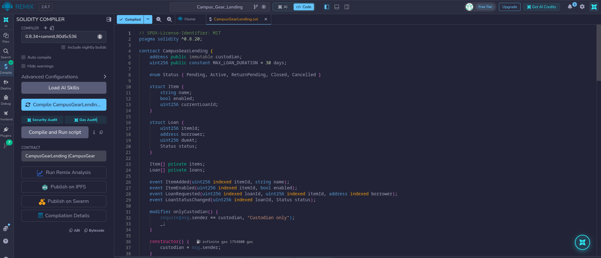
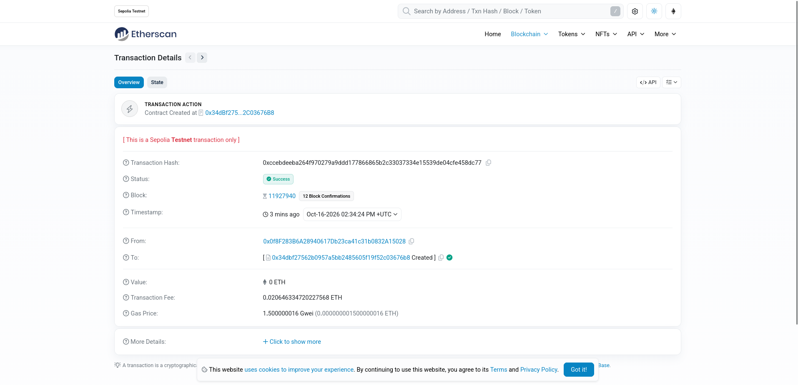

# Campus Gear Lending DApp

Campus Gear Lending is an Ethereum decentralised application (DApp) for managing shared campus equipment such as cameras, projectors, and laboratory devices. It records who requested an item, whether the custodian approved the loan, and whether the equipment has been returned.

## Problem addressed

Equipment lending managed through paper registers or messages can lead to conflicting reservations, unclear responsibility, and disagreements about returns. This DApp maintains a shared on-chain record and applies the same lending rules to every wallet. An item can have only one open request or loan, and a borrower cannot release it for someone else merely by claiming to have returned it.

The blockchain makes recorded actions traceable to wallet addresses and enforces permissions and valid state changes. It does not verify student identity, equipment condition, or physical handover. Those responsibilities remain with the campus custodian.

## How the application works

There are two roles:

- **Custodian:** the wallet that deploys the contract. It adds equipment, enables or disables lending, approves requests, and confirms physical returns. This address is fixed for the lifetime of the contract.
- **Borrower:** any other wallet. It can request available equipment, cancel its pending request, and mark its active loan returned. The contract does not maintain a student membership list.

A typical loan follows this sequence:

1. The custodian adds an equipment name. The contract assigns an item ID and makes it available.
2. A borrower selects the item and a future due date no more than 30 days from the current block timestamp. The request immediately reserves the item.
3. The custodian approves the pending request before its due date, recording an active loan. Physical handover happens outside the application.
4. After returning the equipment, the borrower selects **Mark returned**. The item remains reserved while receipt is being verified.
5. The custodian checks the physical return and selects **Confirm return**. The loan closes and the item can be requested again if it is enabled.

| Current loan state | Action | Permitted wallet | Resulting state |
| --- | --- | --- | --- |
| No open loan | Request loan | Any wallet except the custodian | Pending |
| Pending | Approve | Custodian | Active |
| Pending | Cancel | Requesting borrower or custodian | Cancelled; reservation released |
| Active | Mark returned | Requesting borrower | ReturnPending |
| ReturnPending | Confirm return | Custodian | Closed; reservation released |

Disabling an item prevents new requests and approval of pending requests, but an existing active loan can still complete its return. Due dates do not automatically close loans or cancel requests. An expired pending request must be cancelled by its borrower or the custodian to release its reservation. There are no automatic fines, deposits, payments, or scheduled transactions.

## What the smart contract and blockchain do

The `CampusGearLending` smart contract is the authoritative lending ledger. Each item stores its name, enabled status, and current loan ID. Each loan stores its item ID, borrower address, due timestamp, and status. IDs begin at **1**; a current loan ID of **0** means the item has no open loan. Closed and cancelled loan records remain available.

The contract checks the caller through `msg.sender` and validates every state-changing operation. It rejects unknown IDs, empty or oversized equipment names, invalid due dates, duplicate reservations, incorrect loan states, and actions by unauthorised wallets. These checks apply even if someone bypasses the website and calls the contract directly. A reverted operation does not apply its requested state changes.

MetaMask connects the user's wallet to the interface and signs transactions. Ethers.js translates interface actions into contract calls through the wallet's Ethereum provider. State changes require a confirmed transaction and gas; reading the ledger through view calls does not require a paid transaction. The application waits for transaction confirmation before refreshing its displayed records.

The contract also emits events when items are added or enabled/disabled, loans are requested, and loan statuses change. Transactions and events provide a history of recorded actions. The interface displays the current ledger by reading `custodian()`, `itemCount()`, `loanCount()`, `getItem()`, and `getLoan()`.

On a public network, item names, wallet addresses, and loan dates are public. Solidity's private arrays do not make blockchain data confidential. The system depends on the custodian for truthful physical-return confirmation and is an educational prototype, not an audited lending service.

## Deployment network and contract address

The contract was deployed on Ethereum Sepolia. The confirmed transaction is shown in [the deployment capture](assets/02-deployed1.png), and [Remix shows the deployed instance](assets/02-deployed2.png). The frontend points to this contract on chain ID `11155111`.

| Deployment field | Recorded value |
| --- | --- |
| Frontend and deployment network | Ethereum Sepolia testnet |
| Decimal chain ID | `11155111` |
| Deployed smart contract address | [`0x34dbf27562b0957a5bb2485605f19f52c03676b8`](https://sepolia.etherscan.io/address/0x34dbf27562b0957a5bb2485605f19f52c03676b8) |
| Deployment transaction hash | [`0xccebdeeba264f970279a9ddd177866865b2c33037334e15539de04cfe458dc77`](https://sepolia.etherscan.io/tx/0xccebdeeba264f970279a9ddd177866865b2c33037334e15539de04cfe458dc77) |
| Custodian public address | `0x0f8F283B6A28940617Db23ca41c31b0832A15028` |

See [the deployment record](DEPLOYMENT.md) for interaction hashes still to collect. The automated tests use an ephemeral local Ganache chain; their deployment is not the persistent Sepolia address above.

## Steps to execute the application

You need a browser with MetaMask, test ETH on the selected test network, Python 3 to serve the interface, and internet access for Remix and the frontend's Ethers.js CDN import.

1. Open [Remix](https://remix.ethereum.org/) and copy the source from `contracts/CampusGearLending.sol` into a Solidity file in its workspace.
2. Select a compatible Solidity **0.8.x** compiler (the included [compilation capture](assets/01-compiled.png) shows **0.8.34**) and compile `CampusGearLending`. The local integration test uses 0.8.20. Record the actual compiler version used for any new deployment.
3. In MetaMask, enable test networks if Sepolia is hidden, select **Sepolia**, and select an account funded with Sepolia test ETH. The wallet that deploys becomes the fixed custodian; here that wallet is `0x0f8F283B6A28940617Db23ca41c31b0832A15028`.
4. In Remix's deployment panel, select the browser-extension/injected MetaMask provider. Verify the account and Sepolia network, deploy `CampusGearLending` without constructor arguments, and confirm the transaction in MetaMask. This deployment has already been done; do not redeploy merely to use this frontend.
5. The confirmed address and hash are recorded above and in [the deployment record](DEPLOYMENT.md). If you intentionally deploy a new instance, update both the record and `frontend/config.js` to its new address and chain ID.
6. Confirm `frontend/config.js` points to the contract you intend to use. The committed configuration points to the Sepolia instance above.
7. From the repository root, start the interface:

   ```sh
   python3 -m http.server 8000 --directory frontend
   ```

8. Open `http://localhost:8000` in the browser with MetaMask. Keep the server running while using the application. If using Ganache, keep its node running too.

## Connect MetaMask and interact with the contract

1. Unlock MetaMask and select **Sepolia**. Click **Connect / choose accounts** on the webpage. In MetaMask's account permission dialog, grant this site access to both the deploying custodian wallet and the borrower wallet. If the borrower is absent from the webpage's dropdown, click **Connect / choose accounts** again and grant it in MetaMask. Switching the active wallet inside MetaMask alone does not select the account used by this webpage.
2. In **Connected account**, choose the full custodian address `0x0f8F283B6A28940617Db23ca41c31b0832A15028` and click **Use selected account**. Confirm that the page displays this full address, **Custodian**, chain ID `11155111`, and the full contract address above. Capture the wallet connection screenshot.
3. Enter an equipment name such as `Camera kit` and select **Add item**. Confirm the transaction in MetaMask and wait for the confirmation message and transaction hash. The new item should appear in the inventory.
4. In **Connected account**, choose the different borrower address and click **Use selected account**. Verify **Borrower** and the full address on the page. Both wallets need Sepolia test ETH for their transactions. If MetaMask changes the site's account permissions, reconnect and select the intended account again.
5. Choose the available item and a future due date within 30 days, then select **Request loan** and confirm in MetaMask. The loan should appear as **Pending** and the item as **Reserved**.
6. Select the custodian address in the webpage dropdown, click **Use selected account**, and select **Approve** for the request. Confirm the transaction; its state becomes **Active**.
7. As the borrower, select **Mark returned** after physically returning the item. As the custodian, select **Confirm return** after checking receipt. Confirm each transaction. The loan becomes **Closed** and the enabled item becomes **Available**.
8. Use **Refresh data** to read the current blockchain records again. Capture a successful transaction with its hash and the populated inventory and loan lists.

A pending request can also be cancelled by its borrower or the custodian. Custodian-only actions remain protected by the contract even when an interface control is visible to another account.

## Test cases and observed results

The repository includes a [recorded local integration-test result](evidence/local-test-results.txt):

```text
PASS: local Ganache deployment, full lifecycle, cancellation, invalid and unauthorised calls
```

The observations below refer to that existing local run and the assertions in `tests/integration.cjs`; they are not a new test run, MetaMask test results, or evidence of deployment to Sepolia. The negative-test helper checks that calls throw, but does not assert exact revert messages or mined failed receipts. The listed revert messages are expected from the contract source.

| Category | Test input or action | Expected result | Recorded local observation |
| --- | --- | --- | --- |
| Valid | Add `Camera`; request with a due date about one day ahead; approve; mark returned; confirm return | Loan closes and item reservation clears | Passed; status `3` (Closed) and `currentLoanId = 0` asserted |
| Valid | Request the released item, then cancel as its borrower | Pending request cancelled and reservation clears | Passed; `currentLoanId = 0` asserted |
| Invalid | Custodian adds an empty name | Reject: `Name must be 1-80 bytes` | Passed; call rejected |
| Invalid | Request item ID `99` when only one item exists | Reject: `Unknown item` | Passed; call rejected |
| Invalid | Request with due timestamp `1` (in the past) | Reject: `Due date must be within 30 days` | Passed; call rejected |
| Invalid | A second borrower requests an already reserved item | Reject: `Item unavailable` | Passed; call rejected |
| Unauthorised | Non-custodian adds equipment | Reject: `Custodian only` | Passed; call rejected |
| Unauthorised | Non-custodian approves a pending request | Reject: `Custodian only` | Passed; call rejected |
| Unauthorised | Unrelated wallet cancels another borrower's request | Reject: `Not authorised` | Passed; call rejected |
| Unauthorised | Unrelated wallet marks an active loan returned | Reject: `Borrower only` | Passed; call rejected |

To reproduce the local checks, run the following from the repository root with Node.js and npm installed:

```sh
npm ci
npm test
```

For Remix tests, copy the contract and `tests/CampusGearLending_test.sol` into the same workspace, preserving their relative paths. Enable **Solidity Unit Testing**, select the test file, and run it. The plugin supplies `remix_tests.sol`. Capture the actual results; a Remix test run has not been recorded here.

For a manual unauthorised-call demonstration, create a pending request and use Remix to call `approveLoan(loanId)` from a non-custodian account against the deployed contract. Capture the actual error. A gas-estimation rejection is evidence of a rejected call, not a mined failed transaction; label it accordingly. If a transaction is actually mined and fails, record its hash and failed receipt status. Rejecting a MetaMask signature is also distinct from a contract revert.

## Screenshot evidence

Three genuine captures are included in `assets/`: compilation, a confirmed Sepolia deployment transaction, and the deployed contract in Remix. The remaining interface and transaction captures should be added after the actions actually occur.

| Required screenshot | What the capture must show | Planned path | Status |
| --- | --- | --- | --- |
| Smart contract compilation | Contract name, Solidity compiler version, and successful compilation in Remix | [`assets/01-compiled.png`](assets/01-compiled.png) | Included |
| Smart contract deployment | Deployed contract address, selected network, and confirmed deployment | [`assets/02-deployed1.png`](assets/02-deployed1.png), [`assets/02-deployed2.png`](assets/02-deployed2.png) | Included |
| MetaMask wallet connection | Connected account and role, chain ID, and contract in the interface | `evidence/03-wallet-connected.png` | Pending |
| Successful transaction | A confirmed contract action and its transaction hash | `evidence/04-successful-transaction.png` | Pending |
| Failed transaction | Invalid or unauthorised action with its actual error; include hash/status if mined, otherwise label as a pre-submission rejection | `evidence/05-failed-transaction.png` | Pending |
| Blockchain data in the interface | Populated equipment and loan records, including availability, borrower, due date, and loan status | `evidence/06-blockchain-data.png` | Pending |

The compilation and deployment images can be embedded with:

```markdown


```

The wallet connection, successful action, failed action, and populated data captures remain pending, along with their actual interaction transaction hashes. Keep wallet recovery phrases and private keys out of screenshots and repository files.
